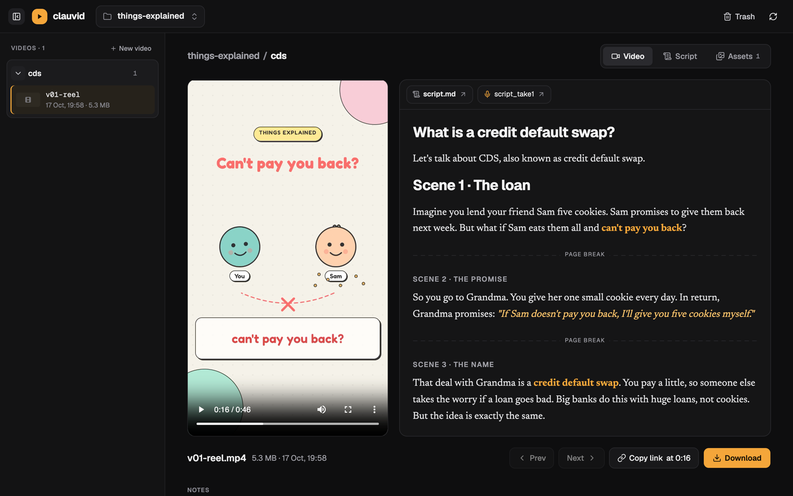
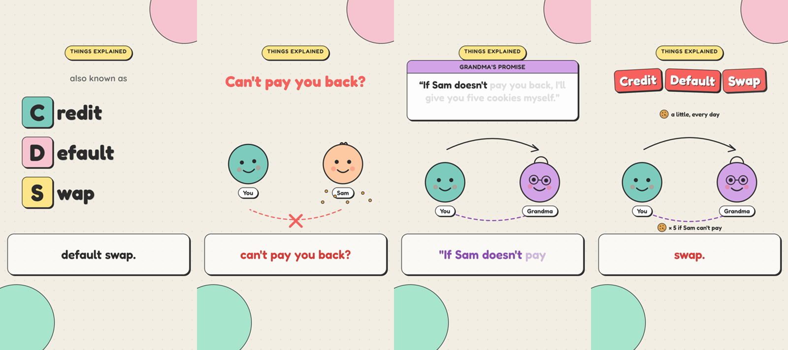
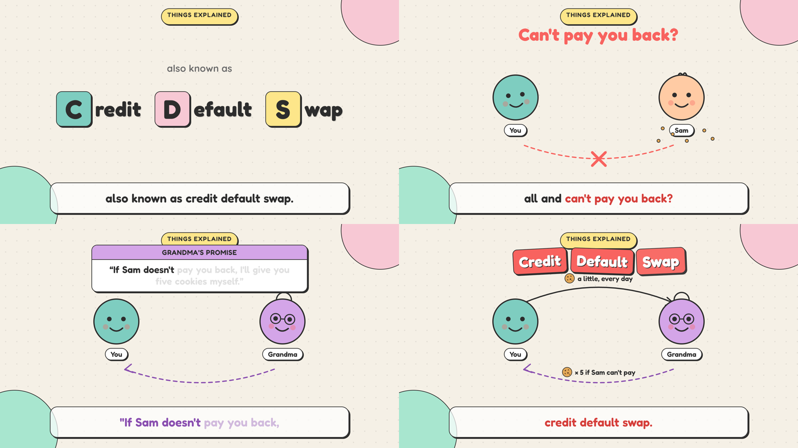
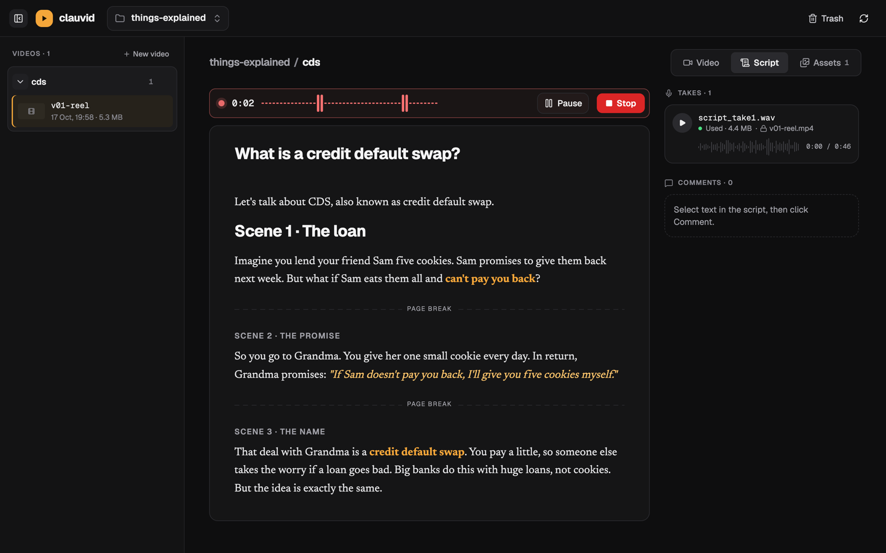
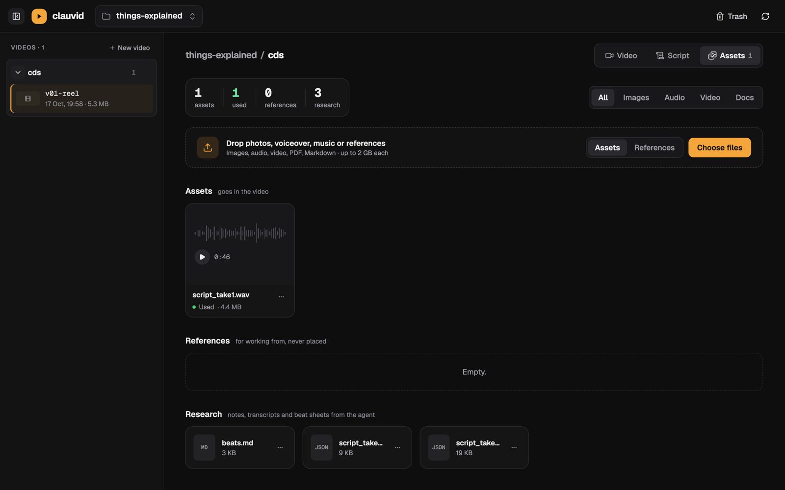
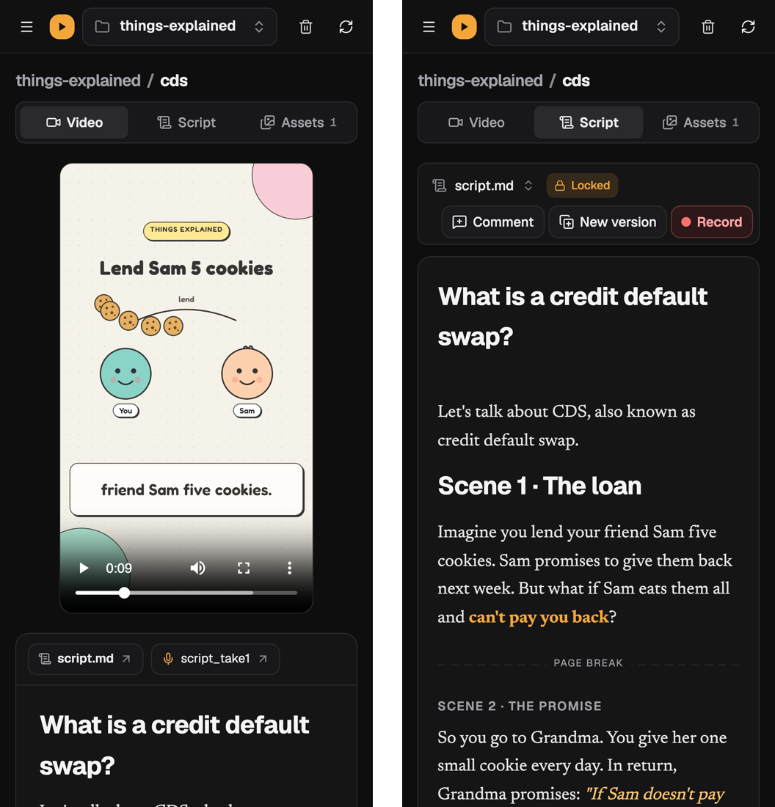

# clauvid

**Make explainer videos with an AI agent: you write the script and record your voice, the agent builds the video, and you review every draft in your browser or on your phone.**

clauvid is a small studio for reels and YouTube videos where the video itself is written as code. You do the parts only you can do: the idea, the words, your voice. An agent ([Claude Code](https://claude.com/claude-code)) does the rest. It reads your script and comments, lines its animations up with your recording word by word, renders a draft, and posts it back for you to review.



## How it works

1. **Write the script** in the platform. Use plain formatting: bold and italic mark what the video should hit hardest, and page breaks split it into scenes.
2. **Record your voiceover** right under the script. Press Record, get a 3-second countdown, read, press Stop. The take is saved and named after the script (`script_take1`, `script_take2`, …).
3. **Ask the agent for a video.** It transcribes your take, matches every spoken word to the script, plans each scene against your timing, and builds the animation: characters, arrows, diagrams, captions, your photos.
4. **Review the draft** on any device. Each draft shows the exact script and take it was made from. Comment on the script, ask for changes, and the agent makes the next draft. Nothing gets overwritten.

The same script and take can become a vertical reel and a horizontal YouTube cut:




*Both made from one script and one take, explaining credit default swaps as simply as possible.*

## The platform

**Script and voice.** A calm editor with only the formatting a voiceover needs, comments on any passage, and a recorder with a live waveform. Your takes sit beside the script, with play, seek, rename and delete.



**Drafts that remember where they came from.** Every draft records which script and take it used. Those two are locked while the draft exists, so the draft can always be reproduced. You can still comment, record new takes, or click **New version** to edit a copy.

**Assets in one place.** Drop in photos, music, clips and reference material. Each asset is marked **Used** or **Not used yet** in the video, and the agent's research (transcripts, beat sheets) is right there too.



**Works on your phone.** The whole platform is responsive: watch drafts, read the script, record, comment, from wherever it's reachable. Every change lands on the computer it runs on.



**Hard to lose things.** Deleting anything goes to Trash, and anything that belongs to it goes along: a draft takes its notes and source, a script takes its comments. Restore brings everything back together.

## Get started

You need macOS, [Homebrew](https://brew.sh), Node 20+ and [Docker Desktop](https://www.docker.com/products/docker-desktop/) (or plain Node, see below).

```bash
git clone https://github.com/kevinaaaquil/clauvid.git && cd clauvid
./setup.sh                     # installs the video toolchain into this folder (safe to re-run)
./run.sh                       # starts the platform at http://localhost:4747
```

`setup.sh` installs everything locally inside the clone: ffmpeg, whisper (speech-to-text) and its model, the HyperFrames renderer, Manim with LaTeX, and MusicGen for background music. A fresh machine downloads about 5 GB. `./setup.sh --minimal` installs only what's needed for voiceover and captions, and `./setup.sh --check` just reports what's there. `./run.sh --native` runs the platform without Docker; `./run.sh stop`, `restart`, `status` and `logs` do what they say.

Then open Claude Code in the folder and ask for a video, e.g. *"Make a reel for the cds video from my take."*

## What's in the repo

Only the platform and its tooling. Your projects (scripts, recordings, assets, drafts), models and caches stay on your machine and are never committed.

| | |
|---|---|
| `share-platform/` | The review platform: a dependency-free Node server and a React + shadcn/ui front end, run in Docker |
| `.claude/skills/` | Agent skills: how to make a video, how to work with the platform, how to sync visuals to a voice take |
| `setup.sh` | One-step toolchain install |
| `run.sh` | Start, stop, restart or check the platform |
| `docs/` | [Agent guide](docs/agent-guide.md) (workflow and house rules), platform design spec and plan |
| `INSTALLED.md` | Everything the toolchain installs, why, and how to remove it |

Videos are rendered with [HyperFrames](https://hyperframes.heygen.com) (HTML + GSAP → MP4) and, for math, [Manim](https://www.manim.community). Speech-to-text runs locally with [whisper.cpp](https://github.com/ggml-org/whisper.cpp). No paid APIs are needed.
